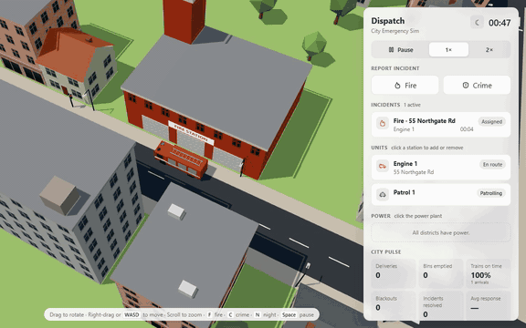
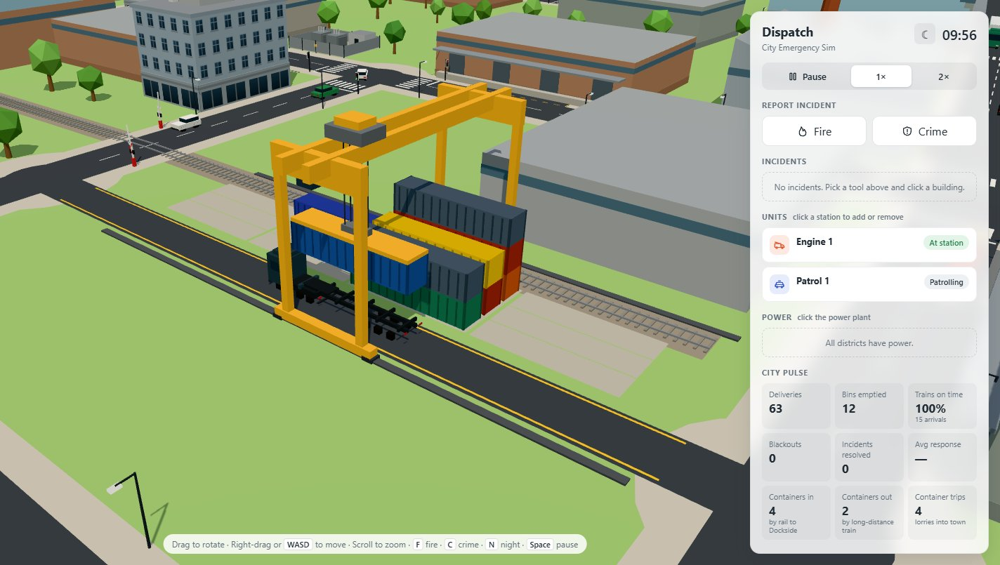
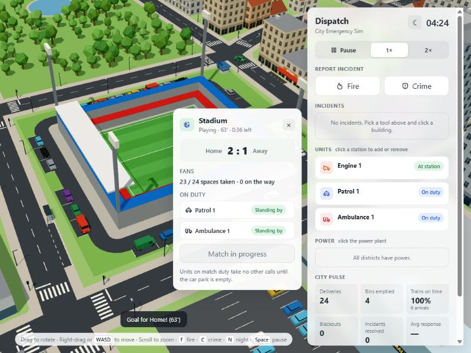
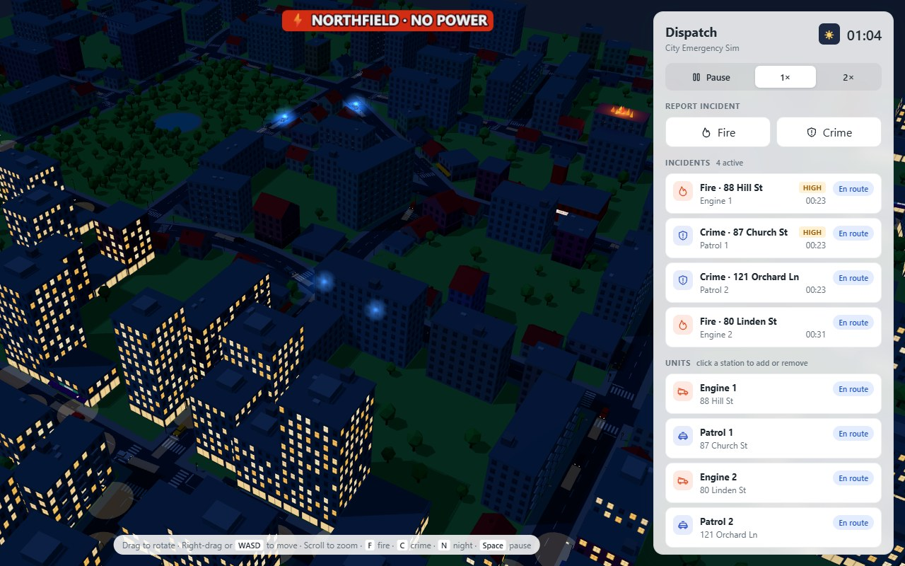
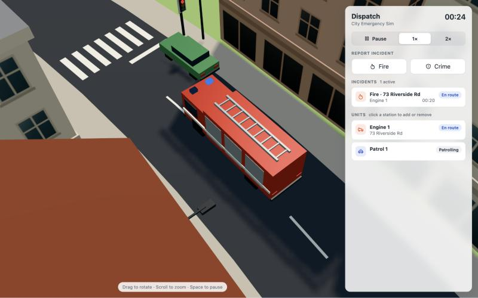

# City Emergency Sim

A small 3D city in the browser with live traffic, traffic lights and an emergency dispatcher.
Click a building to report a fire or a crime, then watch the dispatcher send the nearest unit:
it drives with flashing lights, crosses red lights carefully, civilians pull over to let it
pass, and it works the scene before heading back.

**[▶ Live demo](https://blajak.github.io/city-emergency-sim/)**

[](https://github.com/blajak/city-emergency-sim/actions/workflows/deploy.yml)




## Features

- **Procedural low-poly city.** ~270 streets in nine districts (old town, shopping,
  residential, industrial) with ~1300 buildings: tenements, apartment blocks, houses,
  shops with awnings, offices, a mall, supermarkets, a town hall, a hospital, schools,
  a stadium, a sports hall, a pool, factories, warehouses, a freight hub, a container
  terminal, a waste depot and a power plant. Parks, street lamps, trees, crosswalks, delivery lay-bys.
  Every seed gives the same city (`?seed=42` for a different one).
- **Traffic.** ~200 cars on random routes with realistic car-following (Intelligent Driver
  Model): smooth acceleration, safe gaps, slowing down for turns.
- **Traffic lights.** Phased signals at every intersection with green / yellow / all-red
  stages. Drivers stop for red, decide sensibly on yellow, and left turns yield to oncoming
  traffic.
- **Dispatcher.** Fire and crime reports are processed after a short delay and assigned to the
  available unit with the shortest *route* travel time. Calls have a priority: the power
  plant is critical; the hospital, schools and the mall are high. When every unit is busy,
  calls wait in a queue served by priority, and a more urgent call may take a unit that is
  still on its way to a less urgent one (never one already working a scene).
- **Fire brigade.** Engines leave the station, drive to the building, park at the curb, spray
  water until the fire is out, then return.
- **Police.** One car is always on patrol. If the patrolling car is dispatched, a car waiting
  at the station takes over the patrol; otherwise the first car to finish an incident does.
- **Emergency driving.** Responding units pre-empt intersections, cross red lights at low
  speed, and overtake civilians who pull over to the right. They know the train timetable:
  routes avoid level crossings that will be closed when the unit gets there, and a unit
  switches to a detour on the way when a crossing ahead starts closing. At night their
  beacons light up the street and can be seen across the city.
- **Railway.** Passenger trains run every 2½ minutes in each direction, coming out of a
  tunnel, stopping at West Station and Central Station and leaving through the tunnel on
  the other side. Level crossings close with flashing lights and barriers; cars wait, never
  stop on the tracks, and trains only pass a crossing that is closed and clear.
- **Containers and gantry cranes.** Every 8 minutes a long-distance freight train comes out
  of the east tunnel into the Freight Hub (a locomotive at each end, four container wagons).
  The hub's gantry crane swaps containers between it and the local shuttle, through a buffer
  stack when the shuttle is away; the shuttle takes them to the Dockside terminal, where a
  second crane stacks them. Trains leave only when their crane is done. Containers keep the
  colour of where they came from: cool colours for those from outside, warm ones for those
  loaded in town.
- **Container lorries.** Two lorries drive in on a private road through the Dockside yard,
  wait under the crane (one behind the other) for a container, take it to a warehouse,
  factory or big shop, unload there and bring it back; it then leaves the city by train.
- **Match day.** Click the stadium and **Organise a match**: over three minutes fans drive
  in from homes all over town to their reserved spaces on the one-way loop round the
  stadium, while a police car and an ambulance from the hospital take their own spaces by the
  exit (units on match duty take no other calls). Goals and the final whistle show up as
  messages; at the whistle everyone leaves at once and the gate jams the streets around
  until the car park is empty.
- **Buses.** Three lines with fixed routes, stops about every 300 m and a simple timetable.
  Stops have a bay where the kerb is free; in the old town buses stop in the lane and cars
  drive around them when the opposite lane is clear. Buses pull out of the depot yard,
  join traffic, and go back to park there after their shift. Click a bus or a stop for its
  line, next stops and next departures.
- **Logistics.** Articulated lorries bring goods from the freight hub and factories to
  warehouses and on to supermarkets and the mall; delivery vans serve the shops. They load
  and unload in the delivery bays, off the road. In bigger cities garbage trucks do their
  rounds, stopping in the lane at each building, and unload at the waste depot.
- **Power grid and night.** Click the power plant to switch districts off and on and send
  a utility crew. A district without power loses its traffic lights (junctions run without
  signals) and, at night, its lit windows and street lamps. A fire at the plant cuts a
  random district until the crew repairs it. Press <kbd>N</kbd> for night.
- **Vehicle cards and follow camera.** Click any vehicle or train to see who it is and where
  it is going ("Truck 3 · Factory, 84 Cedar Ave → Warehouse, 84 Abbey St · furniture",
  "Garbage truck 1 · Bin 3 of 8", "Train 2 · Next stop: West Station"). Click a gantry crane
  for the container it is moving, the trains it works for and its stacks. **Follow** keeps the
  camera on it; panning or <kbd>Esc</kbd> lets go.
- **City pulse.** Deliveries made, bins emptied, trains on time, blackouts, incidents resolved,
  the average response time and containers in / out / on lorries, live in the panel.
- **Station management.** Click the fire or police station or the hospital to add or remove
  units (1–3 each).
- **Time controls.** Pause, 1× and 2× speed.









## Controls

| Action | Input |
| --- | --- |
| Rotate camera | Drag |
| Move over the map | Right-drag, two-finger drag, or arrow keys / <kbd>W</kbd><kbd>A</kbd><kbd>S</kbd><kbd>D</kbd> (<kbd>Shift</kbd> = faster) |
| Zoom | Scroll (zooms towards the cursor) |
| Report a fire / crime | **Fire** / **Crime** button, or <kbd>F</kbd> / <kbd>C</kbd>, then click a building |
| Cancel reporting | <kbd>Esc</kbd> |
| Pause / resume | <kbd>Space</kbd> |
| Speed 1× / 2× | <kbd>1</kbd> / <kbd>2</kbd> |
| Add or remove units | Click a station or the hospital |
| Organise a match | Click the stadium, then **Organise a match** |
| Vehicle card / follow camera | Click a vehicle, train or gantry crane, then **Follow** (<kbd>Esc</kbd> to stop) |
| Day / night | <kbd>N</kbd> |

URL parameters: `?seed=<number>` picks the city, `?scale=<1–10>` sets the size (default 10; 1 is a small town), `?cars=<number>` sets the traffic volume and `?debug` shows FPS, simulation cost and draw calls.

## How it works

The simulation is plain TypeScript with no rendering code; Three.js only draws its state. The
simulation advances in fixed 50 ms steps and the renderer interpolates between them, so speed
changes and pausing are trivial and the logic is fully testable in Node.

```
src/
  sim/                 simulation (no DOM, no Three.js)
    world/             city generator: road graph, buildings, trees, lamps, addresses
    traffic/           lane graph, IDM car-following, intersections, emergency driving
    signals/           traffic light controllers and phases
    routing/           fastest-route search over the lane graph (A*, also time-dependent)
    dispatch/          dispatcher, units, incidents, priorities, parking spots
    rail/              trains, level crossings and their closure forecast
    transit/           buses, timetable, depot yard
    logistics/         lorries, delivery vans, garbage trucks, container lorries
    freight/           containers, gantry cranes, the hub and Dockside yards
    power/             districts on/off, utility crews
    events/            match day at the stadium
    Simulation.ts      fixed-step loop tying it together
  render/              Three.js views: city, vehicles and beacons, signals, trains, fire/smoke/water
  ui/                  dispatcher panel, cards (station, bus, power plant, stadium, vehicle), picking, toasts
```

Some of the more interesting parts:

- **Lane graph.** Every street has one lane per direction, ending at the stop lines. Each
  allowed movement through an intersection (straight, left, right; no U-turns) is a Bézier
  *connector*. Connectors whose paths come too close are marked as conflicting.
- **Intersection reservations.** Before entering, the first car in line reserves its
  connector. It only gets it if no conflicting movement is reserved and its exit lane has
  room (counting the cars still crossing into it), and it keeps the reservation until its tail has left the junction. Traffic lights decide
  *who may ask*; reservations guarantee nobody collides. Cars only enter on a reservation.
- **Car-following.** Each driver looks ahead along its planned path for the nearest obstacle:
  a leading car, a stop line, a slower curve or its destination, and applies the
  [Intelligent Driver Model](https://en.wikipedia.org/wiki/Intelligent_driver_model).
- **Emergency vehicles.** Responding units reserve junctions from 60 m away, revoking the
  reservations of cars that can still stop. Cars ahead of them move 1.4 m to the right and
  stop; the unit shifts left just enough to pass the widest car, and nobody moves back until
  it is clear.
- **Long vehicles.** A vehicle's body is placed between its front and rear bumper positions
  along the actual path, so the 8 m fire engine follows curves instead of sticking out.
- **Train forecast.** For every level crossing the rail system predicts when it will be
  closed over the next few minutes (trains on the line, station stops, the freight
  shuttle's way back, the next departures from the tunnels). The barriers close on the same
  forecast, so it is right to within a few seconds.
- **Crossing-aware routing.** Responders route with an A* search whose cost includes the
  expected wait at each crossing at the time they would reach it; the dispatcher uses the
  same times to pick the fastest unit, allowing for arriving a little later than planned.
  Every second, a unit on its way checks whether a crossing ahead is now expected to be
  closed and switches to a faster detour.
- **Gantry cranes.** Each crane works in its yard's own frame (along the track, across it,
  up) and does one move at a time: lift just high enough to clear the stacks, travel with
  the gantry and trolley at once, lower, grab, and the same back. Its next move comes from a
  short priority list (e.g. a long-distance train's containers for town onto the shuttle,
  else into the stack). A train standing at a yard is held while the crane still has work
  for it, and the crossing forecast includes that remaining work.
- **Yard road.** The road through the Dockside yard is an ordinary part of the road network
  (its own T-junctions, reservations, level-crossing rules), but only container lorries may
  route over it, it is one way, and it only allows a right turn in and a right turn out.
- **Match day.** The stadium stands on the island of its car park: one gate in the middle of
  a street, a short two-way access road and a one-way loop with kerb spaces, all ordinary road
  network that only routes starting or ending there may use. Each fan gets a space before
  setting off from a home 300–700 m away, timed from the router's estimate to arrive during
  the three minutes before kick-off; the last two spaces before the exit belong to the duty
  units.

## Getting started

Requires Node.js 20 or newer.

```bash
npm install
npm run dev        # http://localhost:5173
npm test           # simulation test suite
npm run build      # type-check and build to dist/
```

## Tests

The simulation is covered by [Vitest](https://vitest.dev/) suites that run whole scenarios
headless and check every vehicle pair for overlap at every step:

- city generation (determinism, connectivity, no buildings on roads or overlapping),
- traffic with 20–60 cars for 5 minutes: no collisions, no gridlock,
- traffic lights: correct phases, no conflicting greens, no red-light running,
- dispatching: full fire lifecycle, rejections, queue order, nearest-unit selection,
  priorities and diverting a unit to a more urgent call,
- railway: crossings never let a train meet a car, and the closure forecast matches the
  barriers; responders spend far less time at closed crossings than without it,
- buses, lorries, garbage trucks and utility crews: collision-free, in and out of their yards,
- long-distance freight and containers: the train fits the hub clear of the street, cranes
  finish before trains leave, every container is accounted for, nobody but container lorries
  uses the yard road,
- match day: fans park only in their reserved spaces, the car park never overfills, the duty
  units stand by and take no other calls, everyone leaves and the units come back,
- vehicle and crane cards and the city pulse numbers,
- police: patrol hand-over rules, crimes, adding and removing units,
- emergency driving: a stream of incidents with no collisions or stuck units; units cross
  red lights, civilians pull over, and response times stay low.

## Built with

[TypeScript](https://www.typescriptlang.org/), [Three.js](https://threejs.org/),
[Vite](https://vitejs.dev/), [Vitest](https://vitest.dev/). All 3D models and textures are
generated in code; there are no external assets.

## License

[MIT](LICENSE)
