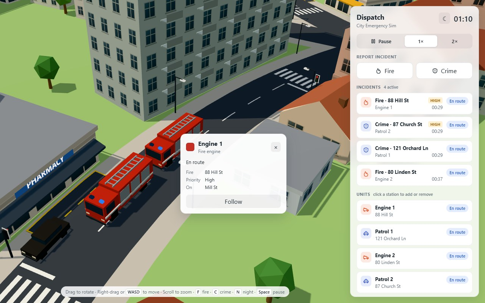

# City Emergency Sim

A small 3D city in the browser with live traffic, traffic lights and an emergency dispatcher.
Click a building to report a fire or a crime, then watch the dispatcher send the nearest unit:
it drives with flashing lights, crosses red lights carefully, civilians pull over to let it
pass, and it works the scene before heading back.

**[▶ Live demo](https://blajak.github.io/city-emergency-sim/)**

[](https://github.com/blajak/city-emergency-sim/actions/workflows/deploy.yml)




## Features

- **Procedural low-poly city.** ~270 streets in nine districts (old town, shopping,
  residential, industrial) with ~1300 buildings: tenements, apartment blocks, houses,
  shops with awnings, offices, a mall, supermarkets, a town hall, a hospital, schools,
  a stadium, a sports hall, a pool, factories, warehouses, a container terminal, a waste
  depot and a power plant. Parks, street lamps, trees, crosswalks, delivery lay-bys.
  Every seed gives the same city (`?seed=42` for a different one).
- **Traffic.** ~20 cars on random routes with realistic car-following (Intelligent Driver
  Model): smooth acceleration, safe gaps, slowing down for turns.
- **Traffic lights.** Phased signals at every intersection with green / yellow / all-red
  stages. Drivers stop for red, decide sensibly on yellow, and left turns yield to oncoming
  traffic.
- **Dispatcher.** Fire and crime reports are processed after a short delay and assigned to the
  available unit with the shortest *route* travel time. When every unit is busy, calls wait in
  a FIFO queue.
- **Fire brigade.** Engines leave the station, drive to the building, park at the curb, spray
  water until the fire is out, then return.
- **Police.** One car is always on patrol. If the patrolling car is dispatched, a car waiting
  at the station takes over the patrol; otherwise the first car to finish an incident does.
- **Emergency driving.** Responding units pre-empt intersections, cross red lights at low
  speed, and overtake civilians who pull over to the right.
- **Railway.** Passenger trains run every 2½ minutes in each direction, coming out of a
  tunnel, stopping at West Station and Central Station and leaving through the tunnel on
  the other side. A freight train shuttles between the freight hub and the Dockside
  terminal. Level crossings close with flashing lights and barriers; cars wait, never
  stop on the tracks, and trains only pass a crossing that is closed and clear.
- **Buses.** Three lines with fixed routes, stops about every 300 m and a simple timetable.
  Stops have a bay where the kerb is free; in the old town buses stop in the lane and cars
  drive around them when the opposite lane is clear. Buses pull out of the depot yard,
  join traffic, and go back to park there after their shift. Click a bus or a stop for its
  line, next stops and next departures.
- **Logistics.** Articulated lorries bring goods from the freight hub and factories to
  warehouses and on to supermarkets and the mall; delivery vans serve the shops. They load
  and unload in the delivery bays, off the road. In bigger cities garbage trucks do their
  rounds, stopping in the lane at each building, and unload at the waste depot.
- **Station management.** Click the fire or police station to add or remove units (1–3 each).
- **Time controls.** Pause, 1× and 2× speed.


## Controls

| Action | Input |
| --- | --- |
| Rotate camera | Drag |
| Move over the map | Right-drag, two-finger drag, or arrow keys / <kbd>W</kbd><kbd>A</kbd><kbd>S</kbd><kbd>D</kbd> (<kbd>Shift</kbd> = faster) |
| Zoom | Scroll (zooms towards the cursor) |
| Report a fire / crime | **Fire** / **Crime** button, or <kbd>F</kbd> / <kbd>C</kbd>, then click a building |
| Cancel reporting | <kbd>Esc</kbd> |
| Pause / resume | <kbd>Space</kbd> |
| Speed 1× / 2× | <kbd>1</kbd> / <kbd>2</kbd> |
| Add or remove units | Click a station |

URL parameters: `?seed=<number>` picks the city, `?scale=<1–10>` sets the size (default 10; 1 is a small town), `?cars=<number>` sets the traffic volume and `?debug` shows FPS, simulation cost and draw calls.

## How it works

The simulation is plain TypeScript with no rendering code; Three.js only draws its state. The
simulation advances in fixed 50 ms steps and the renderer interpolates between them, so speed
changes and pausing are trivial and the logic is fully testable in Node.

```
src/
  sim/                 simulation (no DOM, no Three.js)
    world/             city generator: road graph, buildings, trees, lamps, addresses
    traffic/           lane graph, IDM car-following, intersections, emergency driving
    signals/           traffic light controllers and phases
    routing/           fastest-route search over the lane graph
    dispatch/          dispatcher, units, incidents, parking spots
    Simulation.ts      fixed-step loop tying it together
  render/              Three.js views: city, vehicles, signals, fire/smoke/water, picking
  ui/                  dispatcher panel, station card, building interaction, toasts
```

Some of the more interesting parts:

- **Lane graph.** Every street has one lane per direction, ending at the stop lines. Each
  allowed movement through an intersection (straight, left, right; no U-turns) is a Bézier
  *connector*. Connectors whose paths come too close are marked as conflicting.
- **Intersection reservations.** Before entering, the first car in line reserves its
  connector. It only gets it if no conflicting movement is reserved and its exit lane has
  room, and it keeps the reservation until its tail has left the junction. Traffic lights decide
  *who may ask*; reservations guarantee nobody collides. Cars only enter on a reservation.
- **Car-following.** Each driver looks ahead along its planned path for the nearest obstacle:
  a leading car, a stop line, a slower curve or its destination, and applies the
  [Intelligent Driver Model](https://en.wikipedia.org/wiki/Intelligent_driver_model).
- **Emergency vehicles.** Responding units reserve junctions from 60 m away, revoking the
  reservations of cars that can still stop. Cars ahead of them move 1.4 m to the right and
  stop; the unit shifts left just enough to pass the widest car, and nobody moves back until
  it is clear.
- **Long vehicles.** A vehicle's body is placed between its front and rear bumper positions
  along the actual path, so the 8 m fire engine follows curves instead of sticking out.

## Getting started

Requires Node.js 20 or newer.

```bash
npm install
npm run dev        # http://localhost:5173
npm test           # simulation test suite
npm run build      # type-check and build to dist/
```

## Tests

The simulation is covered by [Vitest](https://vitest.dev/) suites that run whole scenarios
headless and check every vehicle pair for overlap at every step:

- city generation (determinism, connectivity, no buildings on roads or overlapping),
- traffic with 20–60 cars for 5 minutes: no collisions, no gridlock,
- traffic lights: correct phases, no conflicting greens, no red-light running,
- dispatching: full fire lifecycle, rejections, FIFO queue, nearest-unit selection,
- police: patrol hand-over rules, crimes, adding and removing units,
- emergency driving: a stream of incidents with no collisions or stuck units; units cross
  red lights, civilians pull over, and response times stay low.

## Built with

[TypeScript](https://www.typescriptlang.org/), [Three.js](https://threejs.org/),
[Vite](https://vitejs.dev/), [Vitest](https://vitest.dev/). All 3D models and textures are
generated in code; there are no external assets.

## License

[MIT](LICENSE)
